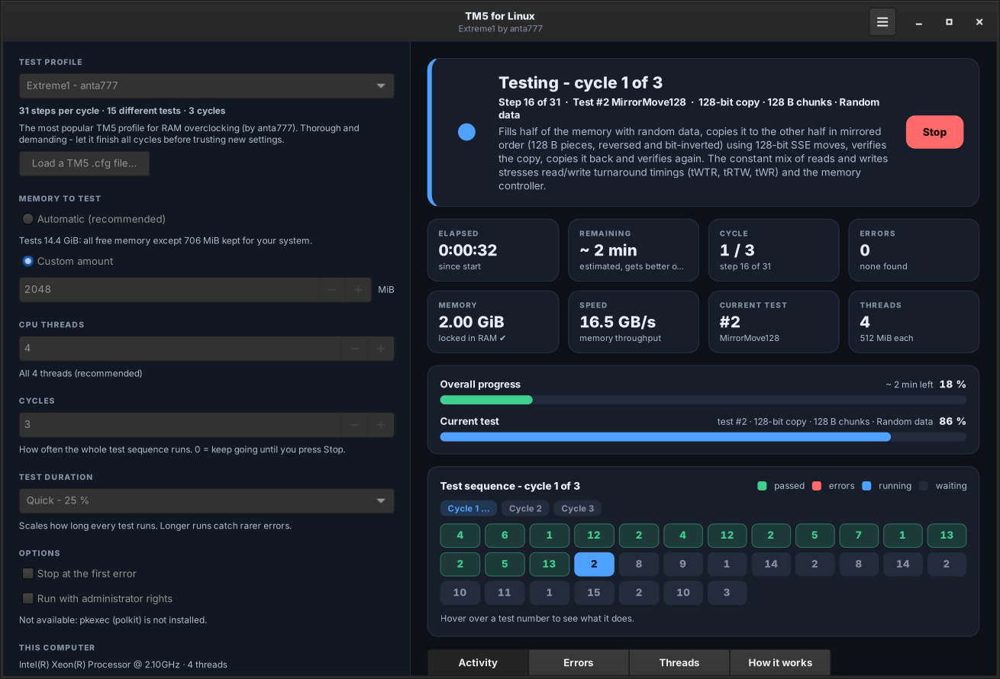
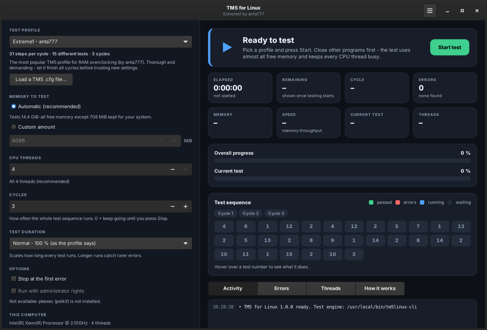
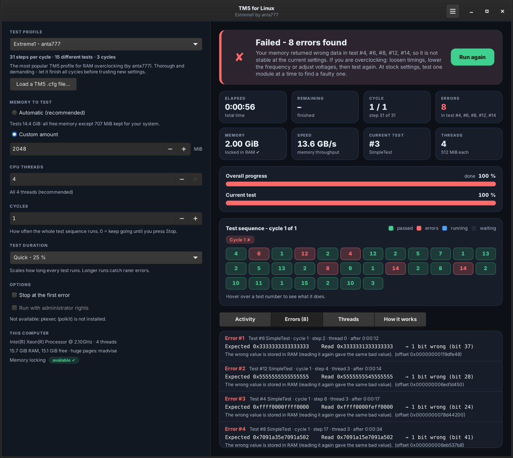

# TM5 for Linux

**A RAM stability tester for Linux that runs TestMem5 (TM5) configs - including the popular
_Extreme1 @anta777_ profile - with a modern dark interface that tells you what is going on.**



TestMem5 is the go-to tool for checking memory overclocks on Windows, but it does not run on Linux.
TM5 for Linux brings the same workflow over: pick a profile, press **Start**, wait for the cycles to
finish, and get a clear **PASSED** or **FAILED** - with every error explained in plain language.

- Reads **TM5 `.cfg` files directly**; ships Extreme1 and ABSOLUT (anta777), Universal2 (LMHz) and PCBDestroyer (Mechan0)
- Implements the TM5 test functions **SimpleTest, MirrorMove, MirrorMove128 and RefreshStable** on every CPU thread at once
- Locks the tested memory in RAM and **bypasses the CPU caches**, so the DRAM itself is tested
- Live **progress, time remaining, speed, errors** and a TM5-style test-sequence view
- Explains **what every test does** and **what every error means** (read error vs. wrong value stored in RAM, which bits flipped, physical address when run as root)
- Keeps the computer awake during a test, notifies you when it is done, saves a log of every run
- Has a full **terminal version** (`tm5linux-cli`) with a live dashboard, for servers or SSH
- Install, update and uninstall scripts for **Arch, Debian/Ubuntu, Fedora, openSUSE, Void, Gentoo** and more, plus native packages (PKGBUILD, .deb, .rpm)

> TM5 for Linux is an independent reimplementation and is not affiliated with TestMem5 or its author.
> TM5 is closed source, so results are comparable in spirit but not bit-for-bit identical - see
> [How the tests work](docs/TESTS.md).

---

## Contents

- [Quick start](#quick-start)
- [Install](#install) - [Arch](#arch-linux-manjaro-endeavouros-cachyos) · [Debian / Ubuntu / Mint](#debian-ubuntu-linux-mint-pop_os) · [Fedora / RHEL](#fedora-rhel-rocky-alma) · [openSUSE](#opensuse) · [Others](#other-distributions)
- [Update](#update)
- [Uninstall](#uninstall)
- [Using TM5 for Linux](#using-tm5-for-linux)
- [Understanding the result](#understanding-the-result)
- [Terminal version](#terminal-version)
- [Troubleshooting](#troubleshooting)
- [Building from source](#building-from-source)
- [Credits and license](#credits-and-license)

---

## Quick start

Works on every common distribution. Open a terminal and run:

```bash
git clone https://github.com/oreo1298/TM5Linux.git
cd TM5Linux
./install.sh
```

The installer explains each step as it goes:

1. detects your distribution and installs the few dependencies with its package manager,
2. builds the test engine,
3. runs a self-test that proves simulated memory errors are found,
4. installs to `/usr/local`,
5. allows the test engine to lock memory (asks first).

Then start **TM5 for Linux** from your applications menu, or run `tm5linux`.

> Don't have `git`? Install it first (`sudo pacman -S git`, `sudo apt install git`,
> `sudo dnf install git`, `sudo zypper install git`), or download the ZIP from GitHub and run
> `./install.sh` inside the unpacked folder (updating then works by downloading again).

---

## Install

You need about 2 MB of disk space. Dependencies (installed automatically by `install.sh`):

| Distribution                          | Packages                                                                      |
|---------------------------------------|-------------------------------------------------------------------------------|
| Arch, Manjaro, EndeavourOS, CachyOS   | `gcc make libcap python python-gobject gtk4`                                  |
| Debian 12+, Ubuntu 22.04+, Mint 21+, Pop!_OS | `gcc make libc6-dev libcap2-bin python3 python3-gi gir1.2-gtk-4.0`     |
| Fedora 36+, RHEL / Rocky / Alma 9     | `gcc make libcap python3 python3-gobject gtk4`                                |
| openSUSE Tumbleweed, Leap 15.4+       | `gcc make libcap-progs python3 python3-gobject python3-gobject-Gdk typelib-1_0-Gtk-4_0` |
| Void Linux                            | `gcc make libcap-progs python3 python3-gobject gtk4`                          |
| Gentoo                                | `sys-libs/libcap dev-python/pygobject gui-libs/gtk`                           |

The window version needs **GTK 4** (4.6 or newer recommended) and **PyGObject**. The terminal version
only needs a C compiler and `make`. Older systems without GTK 4 (e.g. Debian 11) can install with
`./install.sh --cli-only`.

### Arch Linux, Manjaro, EndeavourOS, CachyOS

**Recommended - as a real pacman package:**

```bash
sudo pacman -S --needed git base-devel
git clone https://github.com/oreo1298/TM5Linux.git
cd TM5Linux/packaging/arch
makepkg -si
```

`makepkg` builds the package, runs the self-test, and pacman installs it to `/usr` together with its
dependencies. Memory locking is enabled automatically after installation.

There is also an AUR-ready `tm5linux-git` PKGBUILD in [`packaging/arch/aur/`](packaging/arch/aur/PKGBUILD)
that downloads the latest sources itself.

**Alternative:** `./install.sh` from the repository folder also works on Arch.

### Debian, Ubuntu, Linux Mint, Pop!_OS

**Recommended:**

```bash
sudo apt install git
git clone https://github.com/oreo1298/TM5Linux.git
cd TM5Linux
./install.sh
```

**Alternative - as a .deb package:**

```bash
sudo apt install git build-essential
git clone https://github.com/oreo1298/TM5Linux.git
cd TM5Linux
./packaging/deb/build-deb.sh
sudo apt install ./tm5linux_*.deb
```

### Fedora, RHEL, Rocky, Alma

**Recommended:**

```bash
sudo dnf install git
git clone https://github.com/oreo1298/TM5Linux.git
cd TM5Linux
./install.sh
```

**Alternative - as an RPM package:**

```bash
sudo dnf install git rpm-build gcc make
git clone https://github.com/oreo1298/TM5Linux.git
cd TM5Linux
./packaging/rpm/build-rpm.sh
sudo dnf install ~/rpmbuild/RPMS/*/tm5linux-*.rpm
```

### openSUSE

```bash
sudo zypper install git
git clone https://github.com/oreo1298/TM5Linux.git
cd TM5Linux
./install.sh
```

The RPM route above also works (`sudo zypper install rpm-build`, then `sudo zypper install ~/rpmbuild/RPMS/*/tm5linux-*.rpm`).

### Other distributions

- **Void, Gentoo, Solus, Alpine:** `./install.sh` knows their package managers.
- **NixOS:** run the installer inside a shell with the dependencies:
  `nix-shell -p gcc gnumake libcap python3 python3Packages.pygobject3 gtk4 gobject-introspection --run ./install.sh`
- **Anything else:** install a C compiler, `make`, `setcap` (libcap), Python 3, PyGObject and GTK 4,
  then run `./install.sh --no-deps`.

### Installer options

```text
./install.sh [options]
  --prefix DIR     install location (default: /usr/local)
  --update         update the git checkout and reinstall
  --uninstall      remove TM5 for Linux
  --no-deps        do not install dependencies
  --no-setcap      do not allow memory locking for normal users
  --cli-only       skip the GUI dependencies
  -y, --yes        do not ask questions
```

---

## Update

| You installed with…        | Update with                                                             |
|----------------------------|-------------------------------------------------------------------------|
| `./install.sh`             | `./update.sh` (from the repository folder)                              |
| Arch package (`makepkg`)   | `cd TM5Linux && git pull && cd packaging/arch && makepkg -si`           |
| `.deb` package             | `git pull && ./packaging/deb/build-deb.sh && sudo apt install ./tm5linux_*.deb` |
| `.rpm` package             | `git pull && ./packaging/rpm/build-rpm.sh && sudo dnf install ~/rpmbuild/RPMS/*/tm5linux-*.rpm` |

`./update.sh` downloads the latest version with `git pull`, rebuilds, runs the self-test and
reinstalls - it shows the old and new version. Your settings, own configs and logs are kept.

---

## Uninstall

| You installed with…        | Uninstall with                                                          |
|----------------------------|-------------------------------------------------------------------------|
| `./install.sh`             | `./uninstall.sh` - or, if the folder is gone: `sudo /usr/local/share/tm5linux/uninstall.sh` |
| Arch package               | `sudo pacman -Rns tm5linux`                                             |
| `.deb` package             | `sudo apt remove tm5linux`                                              |
| `.rpm` package             | `sudo dnf remove tm5linux` (openSUSE: `sudo zypper remove tm5linux`)     |

`uninstall.sh` removes exactly the files the installer recorded. Your logs, settings and own configs
in `~/.config/tm5linux` and `~/.local/share/tm5linux` are kept; add `--purge` to delete them too.

---

## Using TM5 for Linux



1. **Close other programs.** The test uses almost all free memory and every CPU thread.
2. **Pick a profile.** *Extreme1 - anta777* is the default and the usual choice for memory
   overclocking. Hover over any test number in the sequence to see what that test does, or open the
   **How it works** tab.
3. **Leave the rest on automatic** (memory, threads, cycles, duration) unless you have a reason to
   change it.
4. Press **Start test**. The memory is prepared first (this can take up to a minute), then the
   tests run:
   - the **status banner** tells you in plain words what is happening right now,
   - the cards show elapsed and remaining time, cycle, errors, memory, speed and the current test,
   - the **test sequence** turns each test green when it passes and red when it finds errors,
   - **Activity** is a running log, **Errors** lists every error in detail, **Threads** shows each CPU thread.
5. Wait for all cycles to finish. You get a notification with the result, and a log is saved in
   `~/.local/share/tm5linux/logs/` (menu → *Open logs folder*).

You can stop at any time - but a stopped run is not proof of stability.

**Your own TM5 configs:** menu → *Load a TM5 config file…* (or copy `.cfg` files into
`~/.config/tm5linux/configs/`). Any config written for TestMem5 works.

---

## Understanding the result



| Result      | Meaning                                                                                  |
|-------------|------------------------------------------------------------------------------------------|
| **PASSED**  | Not a single bit was wrong during the whole run. For overclocked memory, let all cycles finish before trusting the settings. |
| **FAILED**  | The memory returned wrong data at least once. Even one error can crash programs or silently corrupt files: the settings are **not stable**. |
| **STOPPED** | You stopped the run early. No errors so far, but nothing is proven.                       |

Each error tells you:

- **which test** found it (the TM5 test number - useful when comparing with TM5 results from other people),
- **expected vs. read value** and **which bits** were wrong,
- whether it was a **read error** (re-reading gave the right value → usually timings, voltage or frequency) or a **wrong value stored in RAM** (the bits really flipped → often refresh timings, heat, a weak or faulty module),
- the address (and the physical address when running as root).

**What to do after a failure:** if you are overclocking, loosen timings, lower the frequency or adjust
voltages and test again. At stock settings (XMP/EXPO off), errors can mean a faulty module - test one
module at a time.

---

## Terminal version

Everything also works without a desktop:

```bash
tm5linux-cli                              # Extreme1 @anta777 on all free memory, 3 cycles
tm5linux-cli -c absolut                   # another bundled profile
tm5linux-cli -c ~/my-config.cfg -m 12G    # your own TM5 config, test 12 GiB
tm5linux-cli -n 0                         # run until Ctrl+C
tm5linux-cli --describe                   # explain every test of the profile
tm5linux-cli --list-presets               # show available profiles
tm5linux-cli --sysinfo                    # CPU, memory and memory-lock status
tm5linux-cli --selftest                   # prove that bit flips are detected
```

On a terminal you get a live dashboard; when the output is redirected you get plain timestamped lines.
Exit status: `0` passed, `1` memory errors, `2` stopped, `3` could not run.
`--json` prints one JSON event per line (this is what the GUI uses). See `man tm5linux-cli`.

---

## Troubleshooting

**"Memory cannot be locked" / "not locked"**
Without locking, Linux may move parts of the tested memory to swap or zram and errors there could be
missed. The installers fix this by giving the engine the `CAP_IPC_LOCK` capability. If it was skipped:

```bash
sudo setcap cap_ipc_lock=ep "$(command -v tm5linux-cli)"
```

Alternatively tick **Run with administrator rights** in the app (asks for your password via pkexec),
or run the terminal version with `sudo`.

**The window does not open: "TM5 for Linux needs GTK 4 and PyGObject"** - install the GUI packages
from the [table above](#install), or use `tm5linux-cli`.

**The test was killed / the system froze while preparing memory** - something else needed the
memory. Close programs, or choose a *Custom amount* a few GB below the automatic value.

**It takes a long time** - test time grows with the amount of RAM. Choose *Test duration → Quick* for
a first check, but run the full profile before trusting an overclock.

**Laptop / desktop went to sleep** - the app blocks suspend while testing; if your desktop ignores
that, disable automatic suspend for the duration of the test.

**Where are the logs?** - `~/.local/share/tm5linux/logs/`, one file per run.

---

## Building from source

```bash
make                 # builds build/tm5linux-cli and build/tm5linux
make check           # self-test + Python syntax check
./build/tm5linux     # run the GUI straight from the source tree
sudo make install    # PREFIX=/usr/local by default; DESTDIR and PREFIX for packagers
sudo make setcap     # allow memory locking
```

Layout:

| Path                 | What                                                              |
|----------------------|-------------------------------------------------------------------|
| `engine/`            | the test engine in C (`tm5linux-cli`): config parser, tests, runner, terminal UI |
| `gui/tm5linux/`      | the GTK 4 interface in Python; talks to the engine via JSON lines |
| `configs/`           | bundled TM5 profiles                                              |
| `data/`              | desktop entry, icon, AppStream metadata, man page                 |
| `packaging/`         | Arch PKGBUILDs, .deb and .rpm builders                            |
| `docs/TESTS.md`      | exactly how each TM5 setting is interpreted                       |

---

## Credits and license

- **TestMem5** by Serj ([testmem.tz.ru](http://testmem.tz.ru)) - the original Windows tool this project is modelled on.
- **anta777** for the Extreme1 and ABSOLUT profiles, **LMHz** for Universal2, **Mechan0** for PCBDestroyer.
- The profiles were collected by [integralfx/MemTestHelper](https://github.com/integralfx/MemTestHelper).

TM5 for Linux is released under the [MIT license](LICENSE).
